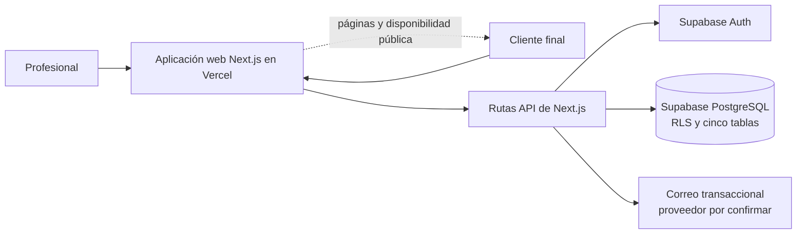

# Diseño del Sistema y Arquitectura: Cita.ai

> Proyecto existente (Brownfield). Documento reconstruido a partir de notas técnicas editadas el 30/10/2025 y una nota operativa del 21/05/2026. No se inspeccionó el código ni la configuración desplegada; el diagrama representa lo documentado, no una verificación del estado actual.

## 1. Stack tecnológico

| Capa | Tecnología documentada | Justificación / estado |
| :--- | :--- | :--- |
| Frontend | Next.js App Router, React, TypeScript (`strict: false`), Tailwind CSS, Radix UI, Lucide, React Hook Form y Zod | Stack registrado en las notas técnicas. No se verificó el repositorio de aplicación. |
| Backend/API | Rutas API de Next.js y cliente tipado de Supabase; sin servidor propio ni ORM | Las notas ubican la lógica de negocio en el código de la aplicación y separan rutas profesionales y públicas. |
| Base de datos y autenticación | Supabase, PostgreSQL, Supabase Auth y Row Level Security (RLS) | Cinco tablas documentadas; `professionals` extiende `auth.users`. No hay migraciones versionadas ni procedimiento documentado para recrear el esquema. |
| Correo | Servicio de correo transaccional de Supabase según las notas técnicas | El proveedor permanece en conflicto con otras fuentes (SendGrid/Resend); uso actual no verificado. Envío descrito como síncrono y con remitente de dominio de prueba. |
| Fechas y formularios | date-fns con locale `es`; React Hook Form y Zod | Dependencias anotadas en la documentación técnica; no se verificaron versiones. |
| Infraestructura y despliegue | Vercel; despliegue automático al hacer push a `main`; variables configuradas manualmente | No se documentan GitHub Actions ni pipeline. La URL de usuarios registrada posteriormente es `cita-ai.vercel.app`; el dominio `cita.ai` no estaba apuntado. |

## 2. Diagrama de arquitectura actual

El diagrama refleja los componentes descritos en las notas. El proveedor exacto de correo, el estado desplegado actual y la conectividad entre ambientes necesitan confirmación.

## 3. Modelo de datos documentado

Las notas técnicas describen cinco tablas en el esquema `public`:

* **`professionals`**: `id` (igual al usuario de `auth.users`), `name`, `email`, `slug`, `appointment_duration_minutes`, `created_at`.
* **`clients`**: `id`, `name`, `email`, `created_at`. `email` es único globalmente; una persona puede quedar compartida entre profesionales.
* **`appointments`**: `id`, `professional_id`, `client_id`, `start_time`, `end_time`, `status`, `created_at`. `status` acepta `confirmed` o `cancelled` mediante check constraint.
* **`availability_rules`**: `id`, `professional_id`, `day_of_week`, `start_time`, `end_time`, `created_at`; `day_of_week`: 0 domingo a 6 sábado.
* **`time_blocks`**: `id`, `professional_id`, `start_time`, `end_time`, `reason`, `created_at`; `reason` no se usa según la nota.

**Relaciones:** un profesional tiene muchas reglas de disponibilidad, bloqueos y turnos; los turnos refieren a un cliente. `professionals.id` referencia `auth.users.id`. El límite de clientes únicos se calcula mediante join entre turnos y clientes, no como relación aislada por profesional. No se documentan claves foráneas o índices completos; no inferir su presencia.

Los horarios disponibles se calculan al vuelo para la semana solicitada, restando turnos confirmados y bloqueos a la grilla derivada de la disponibilidad y la duración configurada.

## 4. Diseño de interfaces (APIs)

* **Estilo:** endpoints HTTP organizados como rutas API de Next.js; no se documenta una especificación OpenAPI.
* **Rutas del profesional (requieren sesión):**
  * `GET /api/appointments` — consultar turnos.
  * `GET /api/clients` — consultar clientes.
  * `PUT /api/professionals/settings` — actualizar configuración.
  * `POST /api/availability/rules` — guardar reglas de disponibilidad.
  * `GET /api/availability/blocks`, `POST /api/availability/blocks`, `DELETE /api/availability/blocks` — consultar y gestionar bloqueos.
  * `POST /api/appointments/[id]/cancel` — cancelar turno desde el área autenticada.
* **Rutas públicas (sin sesión):**
  * `GET /api/public/availability` — obtener horarios disponibles.
  * `POST /api/public/appointments` — crear reserva.
  * `POST /api/public/appointments/[id]/cancel` — cancelar desde enlace público.
* **Seguridad documentada:** Supabase Auth con email y contraseña; rutas del dashboard protegidas por `middleware.ts`; sesión en cookie `httpOnly`, token de 15 minutos y refresh token de 7 días según las notas. RLS está activa en las cinco tablas. Las rutas públicas permiten inserciones necesarias para reservar sin cuenta.
* **Riesgo específico:** la cancelación pública usa credenciales de administrador para evitar RLS; la nota advierte que conocer el ID de turno podría permitir cancelar. El mecanismo de autorización del enlace no está descrito. La ruta pública de reserva no tiene rate limiting documentado.

## 5. Decisiones de arquitectura registradas (ADRs)

* **Aplicación Next.js desplegada en Vercel, con backend gestionado por Supabase.**
  * *Contexto:* el equipo buscaba desplegar en la nube sin administrar servidores y avanzar con tecnología conocida.
  * *Decisión documentada:* Next.js en Vercel; Supabase para PostgreSQL, autenticación y RLS.
  * *Consecuencias conocidas:* push a `main` despliega automáticamente; el servicio de correo puede ejecutarse en el mismo flujo de reserva. No hay pipeline automatizado ni migraciones versionadas documentadas.
* **Disponibilidad calculada al vuelo.**
  * *Contexto:* agendas pequeñas del público objetivo.
  * *Decisión documentada:* generar grilla desde reglas y duración; descontar turnos confirmados y bloqueos.
  * *Consecuencias conocidas:* la nota anticipa revisar este cálculo si el volumen crece; horarios que cruzan medianoche no están soportados.
* **Reserva en operaciones separadas.**
  * *Contexto:* validación del slot, límite gratuito e inserción del turno.
  * *Estado documentado:* doble verificación antes de insertar, sin transacción atómica; una carrera concurrente aún podría crear superposición. La nota menciona una función de PostgreSQL como posible corrección, no como solución implementada.

## 6. Deuda técnica y estrategia de pruebas

* **Integridad de reservas:** ausencia de transacción deja una ventana de carrera. La verificación adicional reduce el riesgo, pero no lo elimina.
* **Acceso público a cancelación:** uso de service role con autorización no descrita; riesgo alto señalado por el autor de las notas.
* **Datos y ambientes:** en 2026 se reportó un único ambiente conectado a datos reales, sin restauración propia; UAT descrito en 2025 habría dejado de usarse. La nota de 2025 también dice que UAT contenía correos reales de profesionales. Confirmar el estado antes de pruebas con datos o correos.
* **Esquema y configuración:** sin migraciones versionadas ni seed; esquema mantenido desde el panel de Supabase. Si se pierde el proyecto, no hay procedimiento conocido para reconstruirlo.
* **Privacidad y exposición:** RLS está activa, pero la tabla `clients` permite inserción pública y los datos de cliente se comparten globalmente por email. Revisar alcance de acceso y modelo de aislamiento; no hay auditoría documentada.
* **Rendimiento y escalabilidad:** la consulta de límite se ejecuta en cada reserva y carece del índice adecuado según la nota. El cálculo de slots no tiene pruebas de carga. Las cifras de tiempo, concurrencia y disponibilidad anotadas son mediciones o estimaciones del desarrollador, no objetivos acordados.
* **Operación:** no hay rate limiting en la reserva pública, monitoreo de disponibilidad ni dashboard de errores; los errores se describen como genéricos. Los envíos de correo son síncronos.
* **Calidad:** las notas declaran que no hay pruebas automatizadas. Como estrategia **propuesta (hipótesis)**, comenzar con pruebas unitarias del cálculo de slots/límite, integración de políticas RLS y reserva/cancelación contra una base aislada, y pruebas E2E de alta, reserva y cancelación. No ejecutadas ni aprobadas; requieren ambiente seguro, fixtures y definición de criterios.

## Fuentes

| Dato / afirmación | De dónde sale |
| :--- | :--- |
| Stack, tablas, relaciones descritas, RLS, auth, endpoints, slots, reserva y límites técnicos | `.context/Confluence-corporativo/04-notas-tecnicas.md` · última edición 30/10/2025; no verificado contra código |
| URL efectiva, un ambiente con datos reales y consecuencias para las pruebas | `.context/Confluence-corporativo/documentacion para QA/nota-ambientes-y-accesos.md` · 21/05/2026 |
| Requisitos funcionales, estado de recordatorio y brechas de producto | `.context/architecture/prd.md` |
| Estrategia de pruebas por niveles | **Hipótesis/propuesta** derivada de riesgos del PRD y ausencia documentada de pruebas; requiere validación del equipo |

## Contradicciones detectadas

* **Ambientes:** `04-notas-tecnicas.md` (30/10/2025) describe UAT y producción separados; `nota-ambientes-y-accesos.md` (21/05/2026) dice que UAT dejó de usarse y que solo queda el ambiente real, sin copia ni restauración propia. Se prioriza la nota posterior; estado desde mayo de 2026 no verificado.
* **URLs y dominio:** las notas técnicas mencionan `cita.ai` y `uat.cita.ai`; la nota operativa posterior identifica `cita-ai.vercel.app` como URL real y dice que el dominio propio no está apuntado. Se toma la URL posterior como última evidencia disponible.
* **Proveedor de correo:** las notas técnicas especifican el servicio de correo transaccional de Supabase; otras fuentes de proyecto mencionan SendGrid y Resend. No se verificó el proveedor en ejecución, por lo que queda abierto.
* **PRD vs. sistema documentado:** el PRD recoge la intención de reservar sin cuenta, cancelar por enlace, aplicar límite de 10 clientes y ofrecer disponibilidad. La documentación técnica describe implementación parcial con endpoint público, validación del límite y cancelación administrativa; a la vez reconoce riesgos de autorización, concurrencia y ausencia de rate limiting. Son brechas/risgos frente a la intención, no prueba de que el PRD esté equivocado.
* **Rendimiento y disponibilidad:** hay cifras medidas/estimadas en las notas técnicas, pero el PRD y la propia nota dicen que no son requisitos acordados. No se convierten en SLA ni criterios de aceptación.

## Preguntas abiertas

* ¿Se puede inspeccionar el repositorio y la configuración actuales para confirmar que el stack y las rutas documentadas siguen vigentes?
* ¿Qué proveedor de correo está conectado hoy y qué credencial/flujo autoriza de forma segura las cancelaciones públicas?
* ¿Existe actualmente un ambiente aislado, respaldo restaurable, seed y migraciones versionadas?
* ¿Qué políticas RLS concretas protegen cada operación y qué datos de clientes puede ver cada profesional?
* ¿Qué solución se adoptará para que las reservas concurrentes sean atómicas? ¿Qué índice requiere el conteo de clientes?
* ¿Cuáles son los objetivos aprobados de rendimiento, concurrencia, disponibilidad, recuperación y compatibilidad?
* ¿Qué prioridad tienen rate limiting, monitoreo, manejo de errores, correo asíncrono y soporte de medianoche?
* ¿Qué alcance de pruebas automatizadas se aprobará y dónde podrán ejecutarse sin afectar usuarios ni enviar correos reales?
