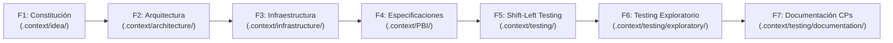

# Cita.ai — Repositorio de Trabajo de QA

> **Base de conocimiento, ingeniería de contexto y artefactos de aseguramiento de calidad (QA) para la plataforma Cita.ai.**

---

## 🎯 Propósito del Repositorio

Este repositorio centraliza todo el contexto de trabajo de QA del proyecto **Cita.ai**, una aplicación web para la gestión de turnos y reservas online orientada a profesionales independientes (disponible en producción en [cita-ai.vercel.app](https://cita-ai.vercel.app/)).

Aquí no reside el código fuente ni la compilación de la aplicación, sino la **infraestructura de contexto de testing**:
- La base de conocimiento histórica y funcional leída por los asistentes de IA.
- La biblioteca de prompts técnicos estructurados por fases para análisis de negocio, arquitectura, refinamiento de especificaciones e inspección estática.
- Las herramientas de prueba asistidas por protocolos MCP (UI con Playwright, APIs con Postman, validaciones en base de datos).
- Los entregables de pruebas generados a lo largo del ciclo de vida del producto.

---

## 📂 Estructura del Repositorio

A continuación se detalla para qué sirve cada carpeta del proyecto:

- **`.context/`**: Base de conocimiento principal (RAG local). Es la memoria que los asistentes y prompts leen como insumo antes de operar y donde se almacenan los entregables de cada fase.
  - **`.context/Confluence-corporativo/`**: Registro histórico no editable del inicio del proyecto (minutas de kickoff, entrevistas, especificaciones y notas técnicas).
  - **`.context/Confluence-corporativo/documentacion para QA/`**: Documentación reciente sobre accesos a producción, alcance de QA y notas de entorno.
  - **`.context/idea/`**: Entregables de la Fase 1 (Constitución: modelo de negocio y análisis de mercado). *(Se genera al ejecutar la fase).*
  - **`.context/architecture/`**: Entregables de la Fase 2 (Arquitectura: PRD, arquitectura técnica y diagramas Mermaid). *(Se genera al ejecutar la fase).*
  - **`.context/infrastructure/`**: Entregables de la Fase 3 (Infraestructura: mapa de componentes y estrategia de datos de prueba). *(Se genera al ejecutar la fase).*
  - **`.context/PBI/`**: Entregables de la Fase 4 (Especificaciones del backlog: historias de usuario y criterios de aceptación en Gherkin/BDD). *(Se genera al ejecutar la fase).*
  - **`.context/testing/`**: Entregables de las Fases 5 a 7 (Shift-Left, inspección estática y análisis de riesgos).
  - **`.context/testing/exploratory/`**: Sesiones de testing exploratorio sobre UI, API y base de datos, junto con reportes de defectos.
  - **`.context/testing/documentation/`**: Casos de prueba formales, matriz de cobertura y cálculo de ROI de automatización.
  - **`.context/ai-project-map.md`**: Mapa integral de contexto que guía el flujo de fases y la arquitectura de la información.

- **`.prompts/`**: Librería de prompts técnicos ("cerebros") organizados en 7 fases consecutivas. Cada prompt asigna un rol técnico, comprueba prerrequisitos y encadena automáticamente con el paso siguiente.
  - **`.prompts/1-Constitucion/`**: Prompts para definición de modelo de negocio y mercado.
  - **`.prompts/2-Arquitectura/`**: Prompts para generación de PRD y diseño de arquitectura.
  - **`.prompts/3-Infraestructura/`**: Prompts para mapeo de entornos y estrategia de datos.
  - **`.prompts/4-Especificaciones (Backlog)/`**: Prompts para desglose y refinamiento de historias de usuario.
  - **`.prompts/5-Shift-Left-Testing/`**: Prompts para inspección estática y matrices de riesgo.
  - **`.prompts/6-Testing Exploratorio/`**: Prompts para sesiones de prueba sobre UI, API y DB.
  - **`.prompts/7-Documentacion CPs/`**: Prompts para diseño de casos de prueba y ROI.

- **`.documents/`**: Base de conocimiento conceptual y metodológica.
  - **`.documents/Fases/`**: Guías explicativas del método detrás de cada una de las 7 fases de testing.

- **`.guides/`**: Manuales técnicos y operativos para la configuración del entorno de trabajo (Git, LLMs, MCPs y Postman).

- **`.agents/`**: Definición de agentes y herramientas portables.
  - **`.agents/skills/`**: Skills automatizadas (`commit`, `documentar-historia`, `revisar-requisito-qa`, `saludar-nombre-agents`) que el asistente carga según la solicitud.

- **`.claude/`**: Configuración y enlaces simbólicos de skills específicas para el entorno Claude Code.

- **`AGENTS.md`**: Directivas de trabajo del repositorio (fuente única de verdad en convenciones de idioma, ramas, commits y seguridad).

---

## 🔄 Flujo de Trabajo (Fases 1 a 7)

El ciclo de aseguramiento de calidad fluye de forma secuencial: cada fase lee lo generado en las anteriores dentro de `.context/` y deposita allí su propio resultado:

- **Fase 1 — Constitución (`.prompts/1-Constitucion/`):** Produce el canvas de negocio y contexto de mercado en `.context/idea/`.
- **Fase 2 — Arquitectura (`.prompts/2-Arquitectura/`):** Genera el PRD y diseño técnico del sistema en `.context/architecture/`.
- **Fase 3 — Infraestructura (`.prompts/3-Infraestructura/`):** Define el mapa de componentes y estrategia de datos en `.context/infrastructure/`.
- **Fase 4 — Especificaciones (`.prompts/4-Especificaciones (Backlog)/`):** Especifica el backlog en Gherkin en `.context/PBI/` (con opción de reconstruir historias mediante la skill `documentar-historia`).
- **Fase 5 — Shift-Left Testing (`.prompts/5-Shift-Left-Testing/`):** Realiza inspección estática de requisitos y matriz de riesgos en `.context/testing/`.
- **Fase 6 — Testing Exploratorio (`.prompts/6-Testing Exploratorio/`):** Ejecuta pruebas sobre UI (Playwright), API y base de datos, documentando sesiones y bugs en `.context/testing/exploratory/`.
- **Fase 7 — Documentación de CPs (`.prompts/7-Documentacion CPs/`):** Diseña casos de prueba formales y evaluación de ROI en `.context/testing/documentation/`.

---

## 📚 Guías Técnicas y Entorno (.guides/)

### Configuración Inicial y Git
- **[Inicio y Setup](.guides/guia-inicio-setup.md):** Instalación de herramientas base (VS Code, terminal, Node.js y Git).
- **[Git — Básico](.guides/Git/git-basico.md):** Comandos esenciales para sincronización y guardado de cambios.
- **[Git — Flujo de Trabajo](.guides/Git/git-workflow.md):** Ciclo de vida de una tarea y formato de mensajes de commit.
- **[Git — Colaboración en Equipo](.guides/Git/git-colaboracion.md):** Gestión de ramas, Pull Requests y revisión entre pares.

### Opciones de Asistentes de IA (.guides/LLMs/)
Configuración según el cliente o asistente utilizado:
- **[Anthropic — Claude Code](.guides/LLMs/claudeCode/claude-Code-CLI-config.md):** Configuración de la CLI y gestión de skills.
- **[OpenAI — Codex](.guides/LLMs/openAI/openai-cli-config.md):** Configuración de cliente y entorno de trabajo.
- **[Google — Antigravity CLI](.guides/LLMs/antigravity/instalacion-antigravity-cli.md):** Instalación y configuración del entorno `agy`.
- **[GitHub Copilot CLI](.guides/LLMs/copilot/copilot-cli-config.md):** Uso de Copilot desde la consola.
- **[GitHub Copilot en VS Code](.guides/LLMs/copilot/copilot-vscode-agente.md):** Modo agente integrado en el editor.

### Opciones de Servidores MCP (.guides/mcps/)
Conexión de herramientas externas mediante Model Context Protocol:
- **[Atlassian / Jira](.guides/mcps/Atlassian/atlassian-mcp-setup.md):** Integración directa para sincronización de backlog y tickets.
- **[Playwright MCP](.guides/mcps/Testing/playwright-mcp-setup.md):** Control del navegador para ejecución y verificación visual de pruebas UI.
- **[Postgres MCP](.guides/mcps/Databases/postgres-mcp-setup.md):** Consulta y verificación directa en bases de datos relacionales PostgreSQL.
- **[SQLite MCP](.guides/mcps/Databases/sqlite-mcp-setup.md):** Integración con bases de datos locales SQLite.
- **[OpenAPI y Postman](.guides/mcps/Testing/openapi-postman-setup.md):** Especificación de contratos y testing de API.

### Pruebas de API con Postman (.guides/postman/)
- **[Postman — Setup Básico](.guides/postman/postman-setup-basico.md):** Preparación del espacio de trabajo y variables.
- **[Postman — Importación de Casos de Prueba](.guides/postman/postman-import-cp-api.md):** Carga y ejecución de colecciones de prueba.

---

## 🛡️ Reglas y Convenciones de Trabajo

De acuerdo con las pautas establecidas en [`AGENTS.md`](AGENTS.md):

- **Idioma:** Toda la documentación y artefactos producidos se redactan en **español**, con ortografía completa y tildes, preservando los nombres técnicos y campos de código en su forma original.
- **Estrategia de ramas:** No se realizan commits directos sobre la rama `main`. Se trabajan mediante ramas temáticas (`docs/...`, `test/...`, `prompts/...`, `fix/...`) con Conventional Commits (`docs(context): ...`, `test(exploratory): ...`).
- **Seguridad:** Las credenciales y claves privadas nunca se commitean. Se gestionan de forma local mediante `.env` (basado en `.env.example`).
